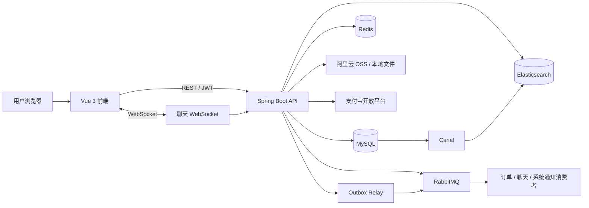
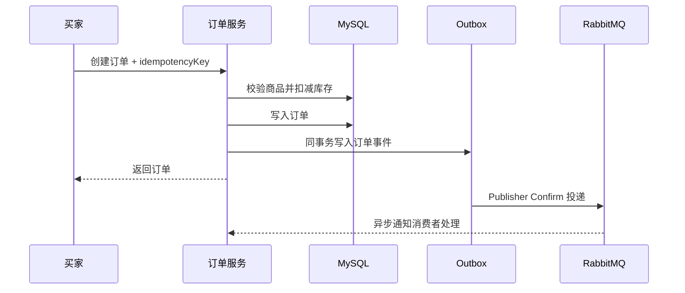

# 智能校园二手交易平台开源文档

> 面向高校学生的前后端分离二手交易系统，覆盖商品发布、收藏、即时沟通、订单履约、支付宝支付、退货退款、评价举报和后台治理等完整交易流程。

[](https://www.oracle.com/java/)
[](https://spring.io/projects/spring-boot)
[](https://vuejs.org/)
[](https://baomidou.com/)
[](https://github.com/xjlznb66/second-handTradingPlatform)

## ☀️ 新手必读

- 后端使用 **JDK 21 + Spring Boot 3.3.5**，不是 JDK 8 项目。
- 前端使用 **Vue 3 + TypeScript + Vite**，`package.json` 要求 Node.js `^22.18.0 || >=24.12.0`。
- 项目启动至少需要 MySQL、Redis 和 RabbitMQ；Elasticsearch、Canal、阿里云 OSS、支付宝沙箱可按需启用。
- 数据库、Redis、RabbitMQ 密码和 JWT 密钥没有不安全的默认值，请先配置环境变量。
- Swagger UI 支持 Bearer Token 调试，登录后把 Token 填入右上角 `Authorize`。
- 仓库当前未附加独立开源许可证，使用、修改或分发前请先确认仓库许可范围。

## ☀️ 项目介绍

**智能校园二手交易平台**是一套围绕校园闲置物品流转设计的完整交易系统。用户可以注册登录、发布和管理商品、搜索商品、收藏商品、与卖家实时私聊、维护收货地址、创建订单并完成支付、确认交易、申请退货退款和发表评价。

管理员可以审核商品、治理用户、处理举报、管理分类并查看平台订单。后端还实现了 Redis 缓存、RabbitMQ 异步消息、Outbox 事务消息、Elasticsearch 商品检索、Canal 增量同步、订单幂等与库存并发控制等工程化能力。

- **后端**：当前仓库，默认运行在 `http://localhost:8081`
- **前端**：本地配套目录 `../fronter`，通过 `VITE_API_BASE_URL` 连接后端
- **接口文档**：`http://localhost:8081/swagger-ui.html`

## ☀️ 功能和特性

### 用户功能

1. **注册与登录**：账号注册、JWT 登录认证、个人资料维护和密码修改。
2. **商品浏览**：分页查询商品，支持关键词、分类、价格、卖家和状态筛选，以及最新、热门排序。
3. **商品发布**：发布、编辑、上架、下架商品，上传多张商品图片并设置封面。
4. **商品收藏**：收藏、取消收藏和分页查看收藏列表。
5. **即时私聊**：创建会话、查看历史消息、标记已读，并通过 WebSocket 接收实时消息。
6. **地址管理**：新增、编辑、删除收货地址，支持设置默认地址。
7. **订单交易**：创建订单、模拟支付或支付宝支付、卖家确认、买家完成、取消订单和超时关单。
8. **退货退款**：买家发起退货申请，卖家审批或驳回，完成后触发退款流程。
9. **交易评价**：完成订单后发表评分和评价，卖家可追加回复。
10. **违规举报**：举报商品或用户，并查看本人提交的举报记录。

### 管理员功能

1. **商品审核**：分页查看商品并执行审核，控制商品是否允许上架。
2. **用户治理**：分页查看用户并调整用户状态。
3. **举报处理**：查看举报记录并更新处理结果。
4. **分类管理**：新增、修改、删除和查询商品分类。
5. **订单查看**：查看平台订单列表和订单详情。

### 项目亮点

1. **前后端分离**：Vue 3 负责页面交互，Spring Boot 提供统一 JSON API。
2. **JWT 鉴权**：通过 MVC 拦截器校验 `Authorization: Bearer <token>`，OpenAPI 配置统一认证方案。
3. **订单幂等**：创建订单使用幂等键，避免网络重试造成重复下单。
4. **库存并发控制**：订单创建、取消和超时关闭围绕库存扣减与回滚设计，防止超卖和重复回补。
5. **事务消息**：使用 Outbox Event 记录业务事件，通过 Relay 投递 RabbitMQ，支持 Confirm、退避重试和死信队列。
6. **实时通信**：原生 WebSocket 提供聊天消息推送，握手阶段校验 JWT。
7. **Redis 缓存**：缓存商品详情、分类和热门商品，并异步聚合浏览量与收藏量。
8. **搜索同步**：业务写入、Canal 监听 binlog、定时窗口对账共同维护 Elasticsearch 商品索引。
9. **支付闭环**：支持支付宝电脑网站支付、通知验签、交易关闭、退款与退款状态对账。
10. **文件存储切换**：商品图片可使用阿里云 OSS，也可切换到本地 `uploads` 目录。
11. **统一异常处理**：通过业务异常、错误码和全局异常处理器返回一致的接口结果。

## ☀️ 项目详细介绍（亮点）

本项目并不是只包含商品增删改查的简单商城，而是围绕校园二手交易场景，实现了从商品发布、沟通议价、下单支付到售后评价的完整业务闭环。同时，项目加入缓存、消息队列、搜索引擎、事务消息、定时任务和并发控制等后端工程化设计，适合作为课程设计、毕业设计和 Java 全栈项目进行学习与扩展。

### ⭐ 用户与账号模块功能介绍

1. **用户注册**：用户填写账号、密码、昵称、手机号和学号等信息完成注册，账号、手机号和学号在数据库中设置唯一约束。
2. **用户登录**：登录成功后签发 JWT，前端将 Token 保存在本地，并在后续请求的 `Authorization` 请求头中自动携带。
3. **个人中心**：用户可以查看和修改昵称、头像、手机号、性别、专业、年级和学号等个人资料。
4. **密码修改**：修改密码前校验原密码，避免登录状态被盗用后直接重置账号密码。
5. **角色与状态**：系统区分普通用户和管理员，并支持正常、禁用、封禁等用户状态，便于管理员治理违规账号。

### ⭐ 商品模块功能介绍

1. **商品发布**：卖家填写分类、标题、售价、原价、库存、商品描述、交易地点、交付方式和联系方式等信息发布商品。
2. **图片管理**：支持上传商品图片、设置封面和图片排序；可使用阿里云 OSS，也可以使用本地目录存储。
3. **商品状态流转**：商品支持草稿、待审核、上架、下架和已售出等状态，避免未审核商品直接进入交易流程。
4. **组合条件查询**：支持按关键词、分类、价格区间、卖家和商品状态查询，并提供最新和热门排序。
5. **商品详情缓存**：热点商品详情写入 Redis，减少重复查询数据库造成的压力。
6. **浏览量聚合**：商品浏览次数先在 Redis 中累计，再由定时任务批量回写 MySQL，降低高频更新数据库的开销。

### ⭐ 搜索与索引同步模块功能介绍

1. **Elasticsearch 检索**：使用 Elasticsearch 保存商品搜索文档，提高关键词检索和复杂筛选场景下的查询效率。
2. **业务实时写入**：商品新增或修改成功后，业务服务会立即尝试同步 Elasticsearch，使搜索结果快速更新。
3. **Canal 增量同步**：Canal 监听 MySQL binlog 中的商品表变更，并将新增、修改、删除事件同步到搜索索引。
4. **定时对账兜底**：定时任务按更新时间窗口扫描数据库，重新同步可能遗漏的数据，避免 Canal 短暂故障导致索引长期不一致。
5. **服务降级**：未启动 Canal 时可以通过 `CANAL_ENABLED=false` 关闭监听，避免本地开发环境持续重连。

### ⭐ 收藏模块功能介绍

1. **收藏商品**：用户可以收藏感兴趣的商品，并在个人收藏页面分页查看。
2. **取消收藏**：用户可以随时取消收藏，接口会校验收藏关系，避免重复操作造成脏数据。
3. **收藏计数**：收藏量通过 Redis 聚合后定时写回数据库，兼顾接口响应速度和最终一致性。
4. **热门商品**：商品浏览量和收藏量可以作为热门排序的重要依据，帮助用户快速发现高关注商品。

### ⭐ 即时聊天模块功能介绍

1. **创建会话**：买家可以从商品详情页发起与卖家的聊天会话，同一商品和买卖双方可复用已有会话。
2. **历史消息**：用户可以分页查看会话列表和聊天记录，并标记消息为已读。
3. **WebSocket 推送**：客户端通过 `/ws/chat` 建立实时连接，不需要频繁轮询即可接收新消息。
4. **JWT 握手认证**：WebSocket 建立连接时校验 Token，防止未登录用户订阅他人的聊天消息。
5. **RabbitMQ 解耦**：聊天事件通过消息队列异步分发，降低消息持久化和实时推送之间的耦合。

### ⭐ 收货地址模块功能介绍

1. **地址管理**：用户可以新增、修改、删除自己的收货地址。
2. **默认地址**：支持设置默认收货地址，下单时可以优先使用，减少重复填写。
3. **归属校验**：地址操作会校验当前登录用户，避免越权查看或修改其他用户的地址。
4. **订单快照**：订单保存收货信息，避免用户后续修改地址影响已经创建的历史订单。

### ⭐ 订单交易模块功能介绍

1. **订单创建**：买家选择商品、数量和收货地址后创建订单，系统校验商品状态、库存和买卖双方身份。
2. **幂等下单**：客户端提交 `idempotencyKey`，相同请求重复发送时不会创建多笔订单。
3. **库存扣减**：订单创建时完成库存扣减，结合数据库更新条件控制并发，降低热门商品超卖风险。
4. **订单状态机**：订单覆盖待支付、待确认、交易中、已完成、已取消和售后等业务状态，并限制非法状态跳转。
5. **订单超时关闭**：定时任务扫描长时间未支付的订单，自动关闭订单、关闭支付宝交易并回补库存。
6. **买卖双方视角**：订单列表支持按买家或卖家身份筛选，方便双方分别处理待办交易。

### ⭐ 支付与退款模块功能介绍

1. **模拟支付**：未启用支付宝时，可以调用本地模拟支付接口验证完整订单流程。
2. **支付宝支付**：启用沙箱配置后，后端生成电脑网站支付表单，引导用户跳转支付宝付款。
3. **异步通知**：支付宝回调接口完成签名验证、金额校验和订单状态更新，避免伪造支付结果。
4. **支付状态查询**：前端可以根据订单号轮询支付状态，及时展示支付成功或失败结果。
5. **交易关闭**：取消订单或订单超时时，系统调用支付宝关单接口，避免关闭后的订单继续付款。
6. **退款处理**：退货完成后创建退款流水并调用支付宝退款，保留退款单号、状态和失败原因。
7. **退款对账**：定时任务扫描待处理或失败退款，回查支付宝结果并修正本地状态。

### ⭐ 退货售后模块功能介绍

1. **发起退货**：买家可以针对符合条件的订单提交退货原因和补充说明。
2. **卖家审批**：卖家可以同意或驳回退货申请，并填写处理备注。
3. **完成退货**：退货流程完成后更新订单和售后状态，并根据支付渠道触发退款。
4. **状态约束**：每个售后操作都会校验当前状态和操作者身份，防止重复审批或越权处理。

### ⭐ 评价模块功能介绍

1. **订单评价**：交易完成后，买家可以对订单商品进行评分并填写评价内容。
2. **防止重复评价**：系统通过订单关系校验，确保同一订单不会被重复评价。
3. **卖家追评**：卖家可以针对买家评价追加回复，形成完整的交易反馈。
4. **评价展示**：商品详情页可以分页展示历史评价，为其他买家提供决策参考。

### ⭐ 举报与平台治理模块功能介绍

1. **提交举报**：用户可以举报违规商品或用户，填写举报类型、原因和详细说明。
2. **我的举报**：用户可以查看自己提交的举报及管理员处理进度。
3. **管理员处理**：管理员查看举报列表，填写处理结果并更新举报状态。
4. **商品审核**：管理员审核待上架商品，阻止违规内容直接公开展示。
5. **用户治理**：管理员可以调整用户状态，对违规账号执行禁用或封禁处理。

### ⭐ 管理后台模块功能介绍

1. **商品管理**：查看商品列表和详情，审核商品并维护商品状态。
2. **用户管理**：查看用户资料、角色和状态，并处理异常账号。
3. **分类管理**：新增、编辑和删除商品分类，为商品发布和筛选提供统一数据。
4. **举报管理**：集中查看和处理用户举报，记录处理意见和最终结果。
5. **订单管理**：查看平台全部订单和订单详情，辅助定位交易纠纷和异常状态。

### ⭐ 高并发与可靠性设计介绍

1. **Outbox 事务消息**：业务数据与消息事件在同一 MySQL 事务中写入，避免数据库提交成功但 MQ 消息丢失。
2. **Publisher Confirm**：消息发布后等待 RabbitMQ 确认，路由失败时记录失败结果并进行重试。
3. **指数退避重试**：消息投递失败后逐步延长重试间隔，避免故障期间持续高频请求消息服务。
4. **死信队列**：消费失败达到重试上限后进入死信队列，便于后续人工排查和补偿。
5. **异步线程池**：耗时通知和后台任务由独立线程池执行，避免阻塞核心接口请求。
6. **定时补偿任务**：订单超时、搜索索引、支付退款、浏览量和收藏量均设置定时任务进行最终一致性补偿。

## ☀️ 快速运行

### 环境要求

| 环境 | 建议版本 | 是否必需 |
| :--- | :--- | :---: |
| JDK | 21 | 是 |
| Maven | 3.9+ | 是 |
| MySQL | 8.x | 是 |
| Redis | 6.x / 7.x | 是 |
| RabbitMQ | 3.x | 是 |
| Node.js | 22.18+ | 前端必需 |
| Elasticsearch | 8.x | 搜索功能建议启用 |
| Docker | 当前稳定版 | 启动 Canal 时需要 |

### 1. 初始化数据库

```sql
CREATE DATABASE trading
  DEFAULT CHARACTER SET utf8mb4
  COLLATE utf8mb4_general_ci;
```

```shell
mysql -u root -p trading < sql/second_hand_trading_platform.sql
```

> `src/main/resources/schema.sql` 会在应用启动时补建支付、退款、退货和 Outbox 相关表，但首次部署仍建议执行完整 SQL 文件。

### 2. 配置环境变量

完整配置示例见 [`env.example`](env.example)。最小启动配置如下：

```powershell
$env:DB_USERNAME = "root"
$env:DB_PASSWORD = "你的 MySQL 密码"
$env:REDIS_PASSWORD = "你的 Redis 密码"
$env:RABBITMQ_PASSWORD = "你的 RabbitMQ 密码"
$env:JWT_SECRET = "至少 32 位的随机字符串"

# 未配置这些服务时建议关闭
$env:OSS_ENABLED = "false"
$env:CANAL_ENABLED = "false"
$env:ALIPAY_ENABLED = "false"
```

也可以在 IDEA 的 **Run/Debug Configurations → Environment variables** 中填写这些变量。

### 3. 启动后端

```shell
mvn clean spring-boot:run
```

- Swagger UI：`http://localhost:8081/swagger-ui.html`
- OpenAPI JSON：`http://localhost:8081/v3/api-docs`
- WebSocket：`ws://localhost:8081/ws/chat?token=<JWT>`

### 4. 启动前端

```shell
cd ../fronter
npm install
npm run dev
```

如后端地址不是默认值，在前端环境变量中设置：

```dotenv
VITE_API_BASE_URL=http://localhost:8081
```

### 5. 启用 Elasticsearch 与 Canal

```powershell
$env:ELASTICSEARCH_URIS = "http://localhost:9200"
```

```shell
docker compose -f docker/canal/docker-compose.yml up -d
```

不使用 Canal 时设置 `CANAL_ENABLED=false`，商品索引仍可由业务写入和定时对账任务维护。

### 6. 启用支付宝沙箱

默认 `ALIPAY_ENABLED=false`，此时可调用模拟支付接口完成本地流程。沙箱接入请查看 [支付宝接入说明](docs/alipay-integration.md)。

## ☀️ 技术选型

### 前端

| 技术 | 作用 | 版本 |
| :--- | :--- | :--- |
| Vue | 页面与组件开发 | 3.5.40 |
| Vue Router | 前端路由与登录守卫 | 4.5.1 |
| TypeScript | 类型系统 | 6.0.0 |
| Vite | 开发服务器与构建工具 | 8.1.5 |
| Fetch API | 调用后端 REST 接口 | 浏览器原生 |

### 后端

| 技术 | 作用 | 版本 |
| :--- | :--- | :--- |
| Spring Boot | 后端基础框架 | 3.3.5 |
| MyBatis Plus | 数据访问与分页 | 3.5.9 |
| MySQL | 核心业务数据 | 8.x |
| Redis | 缓存、计数与在线状态 | - |
| RabbitMQ | 异步事件与通知 | - |
| Elasticsearch | 商品检索 | - |
| Canal | MySQL binlog 增量订阅 | 1.1.8 |
| JWT | 登录令牌 | JJWT 0.12.6 |
| Spring WebSocket | 实时聊天 | 随 Spring Boot |
| springdoc-openapi | Swagger / OpenAPI | 2.6.0 |
| 阿里云 OSS SDK | 商品图片对象存储 | 3.18.4 |
| 支付宝 SDK | 支付、关单与退款 | 4.40.1061.ALL |

## ☀️ 系统架构



## ☀️ 核心设计

### 订单与库存



- 幂等键阻止重复创建同一订单。
- 订单取消、支付超时和退货完成会按业务状态回滚或调整库存。
- 定时任务自动关闭超时未支付订单，并在启用支付宝时同步关闭外部交易。

### 可靠消息

- 业务数据和 `outbox_event` 在同一数据库事务中提交。
- Relay 分批扫描待投递事件，并等待 RabbitMQ Publisher Confirm。
- 投递失败采用指数退避重试，消费异常进入重试或死信流程。

### 商品搜索

- 商品新增或修改后，业务服务立即尝试更新 Elasticsearch。
- Canal 订阅 `trading.product` 的 binlog，实现数据库变更的增量同步。
- 定时任务按 `update_time` 回看窗口重放，修复短暂故障造成的索引遗漏。

### 即时聊天

- REST API 负责创建会话、拉取历史消息和更新已读状态。
- WebSocket `/ws/chat` 负责实时推送，握手时读取并校验 JWT。
- RabbitMQ 用于聊天消息异步分发，Redis 维护在线状态相关数据。

## ☀️ 数据库表设计

| 表名 | 说明 |
| :--- | :--- |
| `campus` | 校园基础信息 |
| `sys_user` | 用户、角色与账号状态 |
| `category` | 多级商品分类 |
| `product` | 商品主体、价格、库存和状态 |
| `product_image` | 商品图片与封面排序 |
| `favorite` | 用户商品收藏关系 |
| `chat_session` | 买卖双方聊天会话 |
| `chat_message` | 聊天消息与已读状态 |
| `shipping_address` | 用户收货地址 |
| `trade_order` | 交易订单、支付和履约状态 |
| `return_request` | 退货申请与处理状态 |
| `order_review` | 订单评价和卖家追评 |
| `report` | 商品或用户举报记录 |
| `outbox_event` | 事务消息事件 |
| `payment_record` | 支付流水 |
| `payment_refund` | 退款流水与对账状态 |

完整字段、索引和约束请查看 [`sql/second_hand_trading_platform.sql`](sql/second_hand_trading_platform.sql) 与 [`src/main/resources/schema.sql`](src/main/resources/schema.sql)。

## ☀️ 主要接口

| 模块 | 路径前缀 | 主要能力 |
| :--- | :--- | :--- |
| 用户 | `/api/users` | 注册、登录、个人资料、修改密码 |
| 商品 | `/api/products` | 发布、编辑、上下架、图片上传、分页查询 |
| 分类 | `/api/categories` | 分类树查询 |
| 收藏 | `/api/favorites` | 收藏、取消收藏、收藏列表 |
| 地址 | `/api/addresses` | 地址增删改查、默认地址 |
| 订单 | `/api/orders` | 下单、支付、确认、完成、取消、退货 |
| 支付宝 | `/api/payments/alipay` | 支付、回调、状态查询、退款查询 |
| 聊天 | `/api/chat` | 会话、历史消息、已读状态 |
| 评价 | `/api/reviews` | 评价、追评、商品评价列表 |
| 举报 | `/api/reports` | 提交举报、我的举报、管理处理 |
| 管理后台 | `/api/admin` | 商品、用户、分类、举报和订单管理 |

除注册、登录和支付宝回调等公开接口外，`/api/**` 请求需要携带：

```http
Authorization: Bearer <JWT_TOKEN>
```

## ☀️ 项目结构

```text
second-handTradingPlatform/
├─ docker/canal/                  # Canal Docker 与实例配置
├─ docs/                          # 架构、支付、搜索同步专项文档
├─ sql/                           # 初始化 SQL 与迁移脚本
├─ src/main/java/.../
│  ├─ address/                    # 收货地址
│  ├─ admin/                      # 管理后台
│  ├─ category/                   # 商品分类
│  ├─ chat/                       # 私聊会话与消息
│  ├─ common/                     # 统一返回、缓存、异常
│  ├─ config/                     # Web、MQ、WebSocket、OpenAPI 配置
│  ├─ favorite/                   # 收藏与计数
│  ├─ order/                      # 订单、退货与消息
│  ├─ outbox/                     # 事务消息
│  ├─ payment/                    # 支付宝支付与退款
│  ├─ product/                    # 商品、图片、搜索同步
│  ├─ report/                     # 举报
│  ├─ review/                     # 订单评价
│  ├─ security/                   # JWT 鉴权
│  ├─ system/                     # 系统通知
│  └─ user/                       # 用户账号
├─ src/main/resources/            # 配置与补充建表脚本
├─ src/test/                      # 订单、Outbox、搜索同步测试
├─ env.example                    # 环境变量示例
└─ pom.xml                        # Maven 依赖
```

## ☀️ 测试与构建

```shell
mvn test
```

```shell
mvn clean package
java -jar target/second-handTradingPlatform-0.0.1-SNAPSHOT.jar
```

```shell
cd ../fronter
npm run build
```

## ☀️ 项目文档

- [项目架构与订单并发流程](docs/interview-diagrams.md)
- [支付宝接入说明（沙箱 / 电脑网站支付）](docs/alipay-integration.md)
- [商品索引同步：Canal 监听 binlog + 定时对账](docs/canal-search-sync.md)

## ☀️ 常见问题

### 后端启动时提示缺少配置

检查 `DB_PASSWORD`、`REDIS_PASSWORD`、`RABBITMQ_PASSWORD` 和 `JWT_SECRET`，这些敏感配置没有默认值。

### Canal 一直重连

本地没有启动 Canal Server 时设置 `CANAL_ENABLED=false`。

### 图片上传失败

没有配置阿里云 OSS 时设置 `OSS_ENABLED=false`，文件会保存到 `UPLOAD_PATH` 指定的本地目录，默认是 `uploads`。

### 前端请求后端失败

检查后端端口和前端 `VITE_API_BASE_URL` 是否一致；默认端口是 `8081`。登录接口以外的大部分接口还需要 Bearer Token。

### Swagger 调用返回未登录

先调用 `/api/users/login` 获取 Token，再点击 Swagger UI 右上角 `Authorize`，只粘贴 Token 内容即可。

## ☀️ 贡献指南

1. Fork 本仓库。
2. 创建功能分支：`git checkout -b feature/AmazingFeature`。
3. 提交修改：`git commit -m "Add some AmazingFeature"`。
4. 推送分支：`git push origin feature/AmazingFeature`。
5. 创建 Pull Request，并说明改动目的和验证方式。

如果这个项目对你有帮助，欢迎点一个 Star ⭐。
