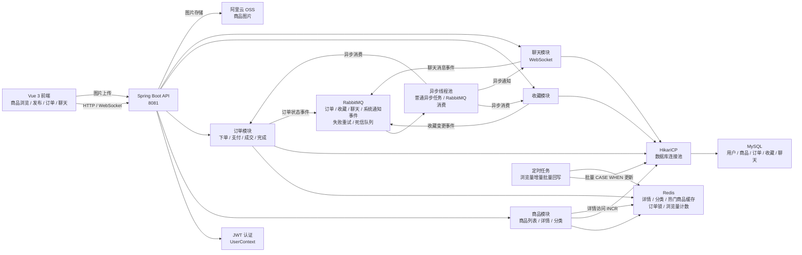
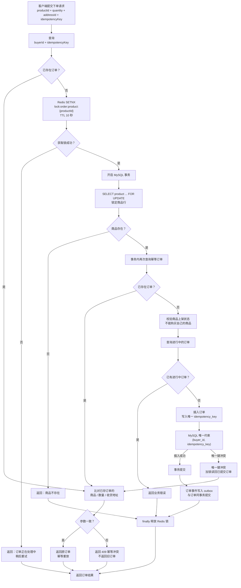
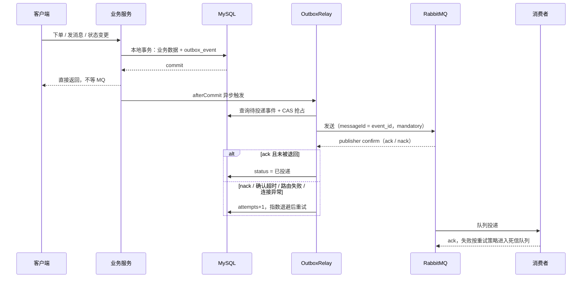

# 项目架构与订单并发流程

## 1. 项目整体架构图

### 架构说明

- **MySQL**：保存最终业务数据，是订单状态、商品信息和浏览量的持久化来源。
- **Redis**：缓存商品详情、分类树和热门商品列表；同时用于商品维度的订单分布式锁，以及浏览量增量计数。
- **RabbitMQ**：异步传递订单状态、聊天消息和系统通知事件，降低主请求链路耗时；生产侧用 outbox 保证提交后不丢事件，消费失败重试后转入死信队列。
- **HikariCP**：复用数据库连接，减少频繁建立连接的开销。
- **异步线程池**：普通异步任务和 RabbitMQ 消费使用独立线程池，避免消息消费占满应用线程。
- **浏览量定时任务**：详情访问只写 Redis，定时把增量批量写回 MySQL，并清理相关缓存。

## 2. 订单并发控制流程图

### 订单并发控制的面试表述

> 下单接口采用三层保护。第一层是幂等请求号，客户端每次提交携带 `idempotencyKey`，重复请求直接返回原订单；命中幂等号后还会比对商品、数量、收货地址，参数不一致说明客户端把新的下单意图复用到了旧请求号上，直接返回 409 幂等冲突，而不是把旧订单当成新请求的结果。第二层是 Redis 商品粒度分布式锁，减少多个实例同时处理同一商品的竞争。第三层是在事务中对商品行执行 `SELECT FOR UPDATE`，由数据库保证最终串行化；同时订单表对 `(buyer_id, idempotency_key)` 建立唯一约束，作为最终兜底，防止重复订单落库，唯一键冲突时加锁读回已提交订单再走一次参数比对。

### 关键边界

- 幂等号只在请求参数完全一致时才可复用。只按 `buyerId + idempotencyKey` 命中就返回旧订单，会让“同一个 key 换成商品 B 再提交”拿回商品 A 的订单，这是静默的错误结果，必须显式拒绝。
- Redis 锁用于削峰和减少竞争，**不能替代数据库事务和唯一约束**。
- 商品行锁必须在事务中使用，否则事务结束后锁立即释放，无法保护后续更新。
- 订单事件不直接发 MQ，而是与订单数据同事务写入 outbox，提交后由投递器异步发送，详见第 3 节。
- 支付、确认成交、完成、取消等状态变更也通过订单行锁串行处理。

## 3. 消息可靠投递（事务性 Outbox）

### 消息可靠投递的面试表述

> 事务提交后再发 MQ 有一个窗口：数据库已经提交、消息还没发出去，进程崩溃或 broker 不可用，这次事件就永久丢了；`afterCommit` 只能避免事务回滚后发出脏消息，不保证提交成功后一定发得出去。补法是事务性 outbox：业务数据和事件行在同一个本地事务里落库，提交之后由独立的投递器异步发送，并等待 broker 的 publisher confirm，收到 ack 才标记已投递；nack、确认超时、路由失败或连接异常按指数退避重试，超过次数置为投递失败留在表里待排查。这样把“业务与消息的原子性”降级为“业务与本地事件表的原子性”，再靠可重试的投递把事件推到 MQ，代价是至少一次投递和秒级延迟。

### 关键边界

- outbox 只保证**至少一次**投递，不保证 exactly once，也不保证严格顺序：重试的事件会被后续事件超过。消费者需要幂等；当前订单、聊天、通知三个消费者只做 WebSocket 广播，重复消费没有副作用，一旦出现落库类消费，必须按 `messageId`（即 outbox 的 `event_id`）去重。
- 消费端的重试和死信队列处理的是**已经进队列**的消息，解决不了“还没进队列”的丢失，两者是互补关系而不是替代关系。
- 投递器用 `update ... where status = 0` 做 CAS 抢占，多实例同时扫描也不会重复投递；实例在“投递中”宕机会把记录留在该状态，超时后自动放回待投递。
- 失败超过上限的记录停在 `status = 3`（默认 30 次、最长间隔 5 分钟，约 2 小时重试窗口），需要人工排查原因后重放：`update outbox_event set status = 0, next_attempt_at = now() where id = ?`。
- 投递依赖 `publisher-confirm-type: correlated`、`publisher-returns: true` 和模板 `mandatory`；缺了确认配置，“发出去”就不等于“broker 收到了”，这个方案会退化成原来的样子。
